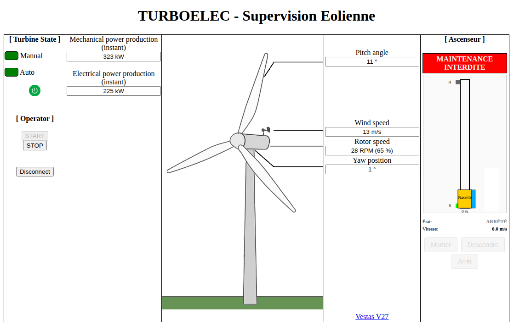

# Instance Docker

## Configuration
Les mots de passe sont configurable dans le fichier Dockerfile :
- mot de passe du compte operateur sur l'IHM (operator par défaut)
- mot de passe d'accès à l'automate Siemens (maint01 par défaut)

## Construction
1. Se déplacer dans le dossier `git_simics/Eolienne/`
2. Executer
```
$ docker build -t simics_eolienne .
```

## Lancement et récupération de l'adresse IP
### Linux
```
$ DOCKER_ID=$(docker run --rm --detach simics_eolienne)
$ docker inspect --format '{{ .NetworkSettings.IPAddress }}' $DOCKER_ID
```

### Windows

*Note : Docker Desktop for Windows ne permet pas l'exposition des ports. L'exemple suivant permet de lier le port du container avec celui de l'hôte*

```
cmd> for /f "delims=" %i in ('docker run --publish 80:80 --publish 502:502 --rm --detach simics_eolienne') do set DOCKER_ID=%i
cmd> docker inspect --format='{{.NetworkSettings.IPAddress}}' %DOCKER_ID%
```

## Services accessibles

```
$ nmap -n -p- --script=modbus-discover <EOLIENNE_IP>
Starting Nmap 7.95 ( https://nmap.org ) at 2026-10-15 16:09 CEST
Nmap scan report for A.B.C.D
Host is up (0.000090s latency).
Not shown: 65532 closed tcp ports (conn-refused)
PORT    STATE SERVICE
80/tcp  open  http
102/tcp open  iso-tsap
502/tcp open  modbus
| modbus-discover: 
|   sid 0x42: 
|     Slave ID data: HAXOM-SIMU-TURBOELEC-1.5.0\xFF
|_    Device identification: HAXOM SIMU-TURBOELEC 1.5.0

Nmap done: 1 IP address (1 host up) scanned in 1.42 seconds
```

- IHM de supervision web [http://<EOLIENNE_IP/](http://<EOLIENNE_IP/) (**l'accès est en HTTP et non HTTPS**)



## Maintenance de l'application

Les services sont supervisés par `supervisord`, qui relance automatiquement tout process qui meurt — pratique en démo pour montrer un service tombé et relancé.

```
# État de tous les services de la simulation
$ docker exec $DOCKER_ID supervisorctl status

# Logs d'un service (ex. le serveur Modbus)
$ docker exec $DOCKER_ID tail -f /tmp/eolienne_server.log

# Relancer / arrêter un service
$ docker exec $DOCKER_ID supervisorctl restart eolienne_process
```

### Exercice défensif : pare-feu local et télémétrie déguisée

Deux services supplémentaires orientent l'exercice de détection/défense :

- **`weather_sync`** (`process/malware.py`) : composante malveillante
  simulée, nommée innocemment dans la liste des process. Elle envoie un
  beacon au C2 (exfiltration d'infos système et Modbus) toutes les
  25–45 s et balaie en Modbus lecture seule les autres éoliennes toutes
  les 90 s. Les beacons identifient la turbine par son nom de parc DNS
  (`turboelec-eolienne-N`, résolu au démarrage) et non par l'ID de
  conteneur ; le beacon de scan part à chaque cycle, même vide
  (signal « balayage bloqué » au C2). Détectable par la capture réseau
  de la page pare-feu, ou à la main par `tcpdump` / `ss` dans le
  conteneur.
- **`firewall_api`** (`process/firewall_api.py`) : micro-API
  (loopback 8081) réservée aux chaînes iptables dédiées
  `TURBOELEC_IN` / `TURBOELEC_OUT`, relayée par la page web
  [firewall.php](http://<EOLIENNE_IP>/firewall.php) : formulaire de
  règles (direction, action DROP/REJECT/ACCEPT, IP, port, protocole),
  liste avec compteurs de paquets filtrés, suppression, reset, et
  **capture réseau** : le stagiaire démarre/arrête un tcpdump depuis la
  page et télécharge le PCAP (snaplen complet, ring borné ~60 Mo) pour
  l'analyser dans Wireshark — pas besoin de shell dans le conteneur.
  Durée bornée à 10 min avec arrêt automatique (une capture « oubliée »
  n'occupe pas le conteneur) ; le téléchargement du PCAP est refusé
  tant que la capture tourne (fichier en cours d'écriture = tronqué).
  Le trafic capturé est brut/sans filtre : beacons vers le C2
  (`tcp.port == 4444`), balayage Modbus (`modbus`) et trafic web de
  fond, comme sur une vraie machine.

Conséquence : le conteneur a besoin de la capacité `NET_ADMIN`
(ajoutée par le docker-compose du dépôt parent). En lancement direct :

```
$ DOCKER_ID=$(docker run --rm --detach --cap-add=NET_ADMIN simics_eolienne)
```

Variables d'environnement utiles au formateur :

| Variable | Défaut | Rôle |
|---|---|---|
| `EOL_C2_HOST` / `EOL_C2_PORT` | `turboelec_c2` / `4444` | adresse du C2 |
| `EOL_BEACON_MIN` / `EOL_BEACON_MAX` | `25` / `45` | intervalle (s) du beacon |
| `EOL_SCAN_INTERVAL` | `90` | périodicité (s) du balayage Modbus |
| `EOL_MAL_ENABLED` | `1` | `0` désactive le malware (démo hors exercice) |

> Accès direct à l'API depuis un shell dans le conteneur :
> `curl -s http://127.0.0.1:8081/api/rules` (GET), les autres
> endpoints sont en POST JSON (`/api/rules`, `/api/delete`, `/api/reset`).

## Dépendances Python

Les versions de `pymodbus` et `python-snap7` sont figées dans `requirements.txt`
(plus dans le Dockerfile) et installées dans le venv `/data/venv` lors du
`docker build` : modifier ce fichier et relancer le build suffit pour changer de
version.

## Arborescence

```
Eolienne/
├── Dockerfile                  # image de la simulation (mots de passe configurables)
├── requirements.txt            # dépendances Python (pymodbus, python-snap7)
├── supervisord.conf            # supervision / relance auto des process
├── IHM_eolienne.png            # capture d'écran de l'IHM
├── process/
│   ├── elevator_common.py      # schéma DB1 ascenseur + helpers partagés (fichier central)
│   ├── wind.py                 # simulateur de vent (rafales), écrit /tmp/wind.txt
│   ├── eolienne_server.py      # serveur Modbus TCP (port 502)
│   ├── eolienne_process.py     # logique de contrôle de l'éolienne
│   ├── ascenseur_server.py     # automate S7comm protégé (port 102) + simu physique
│   ├── ascenseur_process.py    # interlock éolienne / ascenseur
│   ├── ascenseur_api.py        # API REST ascenseur (port 8080, loopback)
│   ├── malware.py              # composante malveillante « weather_sync » (beacon C2 + scan Modbus)
│   └── firewall_api.py         # API pare-feu local iptables (port 8081, loopback)
└── web/                        # IHM PHP (index.php, firewall.php, pics/, phpmodbus/ versionné)
```

Pour toute évolution de la DB1 de l'ascenseur, modifier en premier
`process/elevator_common.py` : les trois process (serveur, interlock et API)
partagent ce schéma via ce module unique.

## Suppression
```
$ docker rmi simics_eolienne
```
